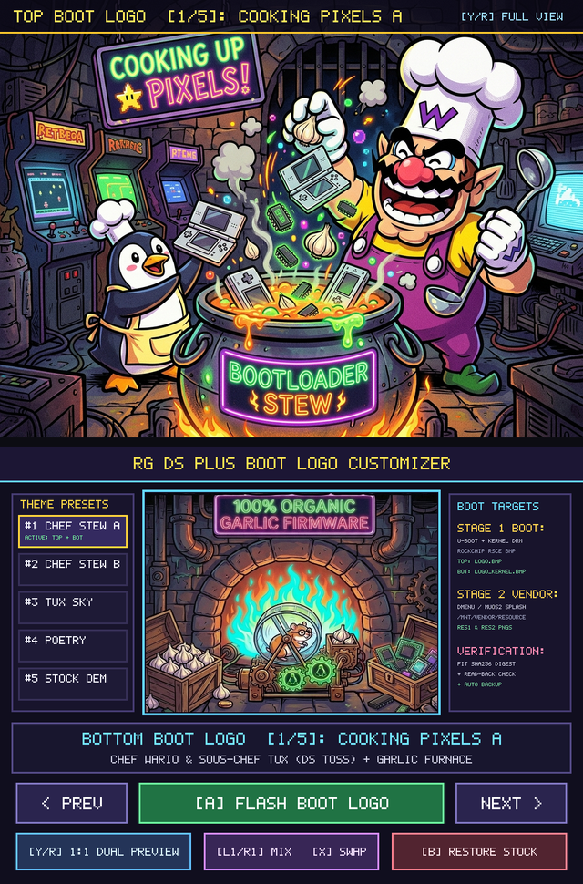
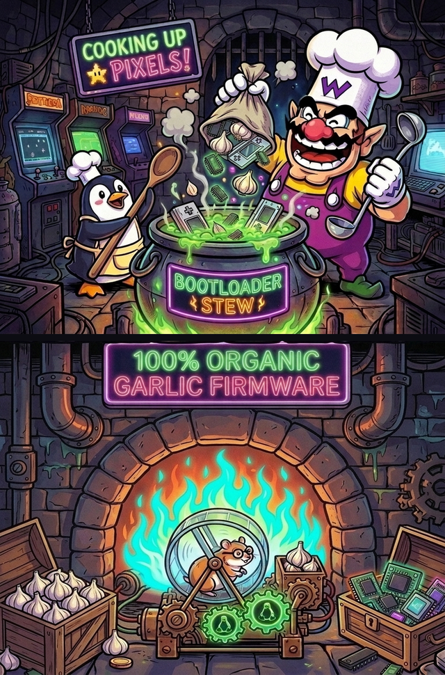
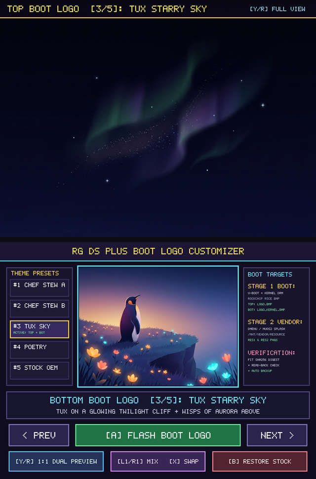
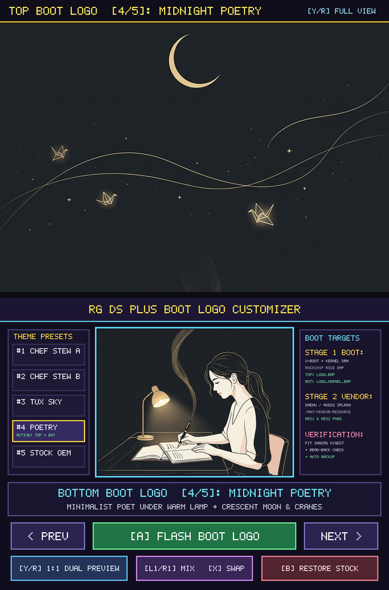
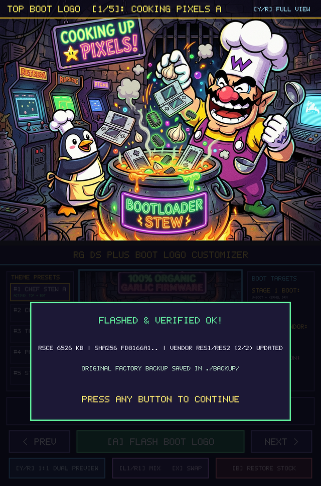

# RG DS Plus Boot Logo Customizer (`boot_logo`)

An on-device dual-screen **Boot Logo Customizer** for the **Anbernic RG DS Plus**, built with the [RG DS Plus Dual-Screen SDK](../sdk/).

It updates **both stages** of the RG DS Plus boot splash directly from the handheld (with automatic backup, SHA-256 verification, and 1-button factory restore), and comes bundled with three whimsical, funny dual-screen themes featuring **Wario** and **Tux the Linux Penguin** alongside the original factory Anbernic boot logos.

---

## Bundled Themes & Screenshots

### 1. Chef Wario & Sous-Chef Tux: Cooking Pixels A (`#1 CHEF STEW A`)
Sliced from a `1024 x 1686` two-story vertical illustration (`768px` top screen + `150px` middle hinge buffer + `768px` bottom screen):
* **Top Screen (`y = 0..768`)**: Master Chef Wario tossing a DS handheld and garlic into a bubbling cauldron of `BOOTLOADER STEW` (`COOKING UP PIXELS!`) alongside Sous-Chef Tux.
* **Bottom Screen (`y = 918..1686`)**: The subterranean brick furnace room beneath the kitchen floor (`100% ORGANIC GARLIC FIRMWARE`), where a hamster in glasses runs on a wheel driving glowing green Linux Tux gears between crates of garlic bulbs and glowing microchips.



### 2. Chef Wario & Sous-Chef Tux: Cooking Pixels B (`#2 CHEF STEW B`)
* **Top Screen (`y = 0..768`)**: Sous-Chef Tux stirring green bubbling `BOOTLOADER STEW` with a giant wooden spoon while Chef Wario dumps a burlap sack of garlic, chips, and handhelds.
* **Bottom Screen (`1:1` Full Dual-Screen Preview shown below, `y = 918..1686`)**: The subterranean brick furnace room beneath the 150px hinge gap.



### 3. Tux Starry Sky (`#3 TUX SKY`)
Sliced from a `1024 x 1686` tall minimalist illustration (`768px` top + `150px` middle hinge buffer + `768px` bottom):
* **Top Screen (`y = 0..768`)**: Deep night sky with only delicate wisps of emerald and violet aurora and pinpoint stars.
* **Bottom Screen (`y = 918..1686`)**: Tux standing on a warm twilight cliff dotted with glowing amber, coral, and cyan wildflowers, gazing up at the sky above.



### 4. Midnight Poetry (`#4 POETRY`)
Sliced from a `1024 x 1686` minimal, sleek editorial line-art illustration (`768px` top + `150px` middle hinge buffer + `768px` bottom):
* **Top Screen (`y = 0..768`)**: A slender crescent moon, glowing origami paper cranes, and flowing golden ink lines drifting across calm dark negative space.
* **Bottom Screen (`y = 918..1686`)**: A young woman seated at a minimalist desk under a warm lamp, writing poetry with a fountain pen as a delicate golden wisp rises upward.



### 5. Flashing & Read-Back SHA-256 Verification
Pressing **`A`** opens a confirmation dialog and flashes both Stage 1 (`/dev/mmcblk1p3` FIT + Rockchip `RSCE` resource container) and Stage 2 (`/mnt/vendor/resource/res{1,2}/boot/logo{,2}.png`), recomputing and verifying the FIT SHA-256 digest before reporting completion:



---

## How the Anbernic RG DS Plus Boot Logo Works

Reverse engineering the factory firmware image (`RG-DS-PLUS-EN16GB-V1.0-20260915.IMG`, Rockchip RK3568 `aarch64`) revealed a **two-stage dual-screen boot splash pipeline**:

1. **Stage 1 — U-Boot + Linux Kernel DRM (`boot` partition, `/dev/mmcblk1p3`)**:
   * Partition 3 (`boot`, LBA `32768`, 64 MB) is a Flattened uImage Tree (**FIT**) image (`magic = 0xd00dfeed`).
   * Its final sub-image is `/images/resource` (`data-position = 0x25d1200`), which holds a **Rockchip Resource Container (`RSCE`)** containing 11 `ENTR` entries (512-byte block aligned): `rk-kernel.dtb`, `battery_0.bmp`..`battery_5.bmp`, `battery_fail.bmp`, `battery_null.bmp`, **`logo.bmp`** (displayed on the **Top Screen**, `route-dsi1`), and **`logo_kernel.bmp`** (displayed on the **Bottom Screen**, `route-dsi0`).
   * U-Boot's Rockchip DRM driver requires uncompressed BMPs (`biCompression = 0`, 24-bit BGR) with a **negative `biHeight` (`-768`)** indicating a **top-down scanline order** (`1024x768`).
   * Because `/images/resource` is located at the very end of the FIT payload (`0x25d1200`), `boot_logo` repacks the 11-entry `RSCE` container in memory with the selected `1024x768` 24-bpp top-down BMPs (`2,359,350` bytes each, well inside U-Boot's `8 MB` `MAX_IMAGE_BYTES` limit and `64 MB` partition size), computes the new **SHA-256** digest of the `RSCE` blob, updates `/images/resource/data-size`, `/images/resource/hash/value`, and the FDT `totalsize` header, writes the updated container and FIT header to `/dev/mmcblk1p3`, and performs a full read-back SHA-256 verification.
2. **Stage 2 — Userspace Launcher Cold-Boot Splash (`vendor` partition, `/dev/mmcblk1p8` mounted at `/mnt/vendor`)**:
   * When `/mnt/vendor/bin/dmenu.bin` (or `muos2.bin`) starts on cold boot (before `/tmp/boot.ini` is created), it loads `/mnt/vendor/resource/res1/boot/logo.png` (Top Screen) and `/mnt/vendor/resource/res1/boot/logo2.png` (Bottom Screen) — or `res2/boot/` depending on the UI theme — via `IMG_Load()` and renders them at `1024x768` for 1 second while initializing audio and storage.
   * `boot_logo` updates both `res1/boot/` and `res2/boot/` PNG pairs so the transition from Stage 1 (U-Boot/Kernel) to Stage 2 (Userspace) is completely seamless.

---

## Controls

| Handheld Control | Linux Desktop Simulator (`boot_logo_linux`) | Action |
| :--- | :--- | :--- |
| **D-Pad Left / Right** | `Left` / `Right` Arrow | Cycle both Top & Bottom screens through the 4 themes |
| **`L1` / `R1` Shoulder** | `Q` / `E` | Independently cycle Top (`L1`) or Bottom (`R1`) screen to mix & match themes |
| **`X` Button** | `W` | Swap Top and Bottom screen logos |
| **`Y` Button / D-Pad Up/Down** | `A` / `Up` / `Down` | Toggle `1:1` Full Dual-Screen Preview (hides HUD overlays) |
| **`A` Button** | `D` / `Enter` | Open Flash Confirmation dialog / Confirm flash |
| **`B` Button** | `S` / `BackSpace` | Open Restore Factory Stock dialog / Cancel modal |
| **Bottom Touchscreen** | Left Mouse Click | Tap preset cards (`#1`..`#4`) or action buttons directly |
| **`START` / `SELECT` / `MENU`** | `Enter` / `Right Shift` / `Esc` | Exit application |

---

## Building & Running

### 1. Build for Anbernic RG DS Plus (`aarch64`) and SD Card Package
```bash
make
```
This builds the `aarch64` binary (`boot_logo`) and populates `sdcard_package/` with ready-to-copy directories for both `Roms/APPS/` and `Ports/`:
* `sdcard_package/Roms/APPS/Boot_Logo.sh` & `sdcard_package/Roms/APPS/boot_logo/`
* `sdcard_package/Ports/Boot_Logo/`

### 2. Build and Test on Linux Desktop (`x86_64` X11 Simulator)
```bash
make linux
./boot_logo_linux
```
On desktop Linux (`-DHOST_X11`), `boot_logo_linux` automatically creates a safe sandbox in `/tmp/rgds_sim_boot.img` (containing a genuine FIT header + Rockchip `RSCE` resource container with all 11 entries) and `/tmp/rgds_sim_vendor/resource/res{1,2}/boot/`, allowing you to test the full `RSCE` container repacking, FDT `data-size` patching, and SHA-256 verification flow without touching host block devices.
