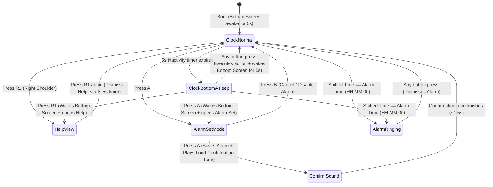

# Night Clock (`night_clock`) — Design Document

**Target Platform:** Anbernic RG DS Plus (Dual `1024×768` IPS Displays, Rockchip RK3568 `aarch64`) & Linux X11 Desktop Simulator (`x86_64`)  
**SDK:** Anbernic RG DS Plus Native C SDK (`../sdk/include/rgds_sdk.h`, `../sdk/src/rgds_sdk.c`)  
**Directory:** `~/xkdr/a/anbernic_rgds_plus/night_clock`

---

## 1. Overview & Finalized Design Choices

`night_clock` is a dual-screen bedside and desk clock built on the RG DS Plus C SDK:
- **Top Screen (`RGDS_SCREEN_TOP`, `1024×768`)**: Always-on time display in **24-hour format**, switchable with **`X`** between a **Retro LED Dot-Matrix Bit-Font Digital Clock** and a **Minimalist High-Contrast Analog Clock**. Every **10 minutes**, the clock center shifts along a bounded orbit to prevent IPS image retention / burn-in.
- **Bottom Screen (`RGDS_SCREEN_BOTTOM`, `1024×768`)**: Shows the **Date** (in the shifted timezone), **Timezone Shift**, **Alarm Status**, **Brightness**, and **Critical Button Mappings** (`[A] Alarm/Set`, `[UP/DN] Brightness`, `[X] Digital/Analog`, `[R1] Help`) for **5 seconds** at startup, then powers off.
- **Courtesy Wake + Immediate Action:** When the bottom screen is asleep, the first button press **immediately performs its action** (e.g., adjusts brightness, shifts timezone, toggles Digital/Analog, opens Alarm Set, or opens Help) **and simultaneously wakes up the bottom screen** for 5 seconds so the user can see the date and updated state.
- **Right Shoulder (`R1` / `R2`) Help Screen:** Pressing the Right Shoulder button (`R1`) opens a full **Help Screen** on the bottom display listing all button mappings; pressing `R1` again dismisses Help.
- **Linux X11 Desktop Simulator (`-DHOST_X11`)**: Mimics the hardware bottom-screen power-off state by rendering a **"SCREEN OFF"** overlay on the bottom screen when asleep, and showing the full Date / Alarm / Help UI when awake.

---

## 2. Core Features

### (0) Local Timezone Shift (`LEFT` / `RIGHT`)
- **App-Local Offset Only:** Pressing **D-Pad `LEFT`** or **`RIGHT`** shifts the clock's displayed time in **30-minute increments** (`-30 min` / `+30 min`) relative to the device's system clock (`time(NULL)` + `localtime()`). The OS/device timezone and hardware RTC are **never** modified.
- **Range & Display:**
  - Supports offsets from **`-24:00` (`-48` half-hours)** to **`+24:00` (`+48` half-hours)**, covering all global timezone differences including `30`-minute zones (`+05:30`, `+09:30`, `-03:30`).
  - Displayed relative to device time as `DEV +00:00`, `DEV +05:30`, `DEV -03:30`, etc.
  - Holding `LEFT` / `RIGHT` continuously steps the offset with auto-repeat (`320 ms` initial delay, `100 ms` repeat interval).
- **Date Rollover:** Computed by adding `tz_shift_minutes * 60` to the device's local epoch structure and normalizing via `mktime()` so that shifting across midnight accurately advances or rewinds the **Date** and **Day of Week** shown on the bottom screen.
- **Persistence:** Saved immediately to `.night_clock.cfg` on the SD card (`/mnt/sdcard/Roms/APPS/night_clock/.night_clock.cfg`, `/mnt/mmc/Roms/APPS/night_clock/.night_clock.cfg`, or `~/.night_clock.cfg`) and restored automatically on next boot.

---

### (1) Digital / Analog Display (`X` Key) & 10-Minute IPS Burn-In Protection
- **Mode Toggle (`X` Key):**
  - Pressing **`X`** switches the Top Screen (`RGDS_SCREEN_TOP`) between **Digital** and **Analog** clock faces.
  - Always uses **24-hour format** (`00:00` – `23:59`) in Digital mode.
  - The active display mode (`digital` vs. `analog`) is persisted in `.night_clock.cfg`.
- **10-Minute IPS Anti-Burn-In Orbit:**
  - Every **10 minutes** (`slot = (uptime_minutes / 10) % 9`), the anchor center `(cx, cy)` of the Top Screen clock shifts across a 9-point bounded orbit around the `1024×768` screen center `(512, 384)`:
    - Digital mode shifts up to `±80 px` horizontally and `±65 px` vertically.
    - Analog mode shifts up to `±60 px` horizontally and `±40 px` vertically.
  - When transitioning from one 10-minute slot to the next, the center glides smoothly over ~1 second rather than jumping abruptly, ensuring no static high-contrast pixels stay lit in one place overnight.

---

### (2) Bottom Screen Date Display, Critical Controls, Help (`R1`), & 5-Second Auto-Sleep
- **Startup & Courtesy Wake Behavior:**
  - On launch, the **Bottom Screen (`RGDS_SCREEN_BOTTOM`)** turns on and displays the **Date & Status View** for **5 seconds** (`BOTTOM_WAKE_DURATION_MS = 5000`).
  - After 5 seconds of no input (when not in Alarm Set or Help mode), the Bottom Screen enters **Sleep Mode**:
    1. On RG DS Plus hardware (`!HOST_X11`): clears the bottom framebuffer to pure black (`0x000000`) and powers off the lower panel backlight via `/sys/class/anbernic_misc/lcdoff` (`1` when `lcdswap == 0`, `2` when `lcdswap == 1`) + `/mnt/vendor/bin/bright.dge`.
    2. On Linux X11 desktop (`HOST_X11`): renders a dark screen with a clear **"SCREEN OFF"** overlay so desktop testing visibly shows when the bottom screen is powered off vs. awake.
  - Pressing **any button** while the bottom screen is asleep **executes that button's action immediately** AND wakes the bottom screen for 5 seconds.
- **Bottom Screen Layout (`1024×768` Native):**
  - **Day of Week & Full Date Readout:** Large, clean uppercase day of week (e.g., `MONDAY`) and full date in the shifted timezone (e.g., `OCTOBER 19, 2026`).
  - **Status Cards:**
    - **Timezone Shift:** `TZ SHIFT: DEV +00:00` (plus raw device time comparison)
    - **Alarm Status:** `ALARM: 07:00 [ON]` or `ALARM: 07:00 [OFF]`
    - **Brightness:** `BRIGHTNESS: 6 / 10`
  - **Critical Button Mappings Bar:**
    - Prominently displays:
      - `[A] ALARM / SET`
      - `[UP/DN] BRIGHTNESS`
      - `[X] DIGITAL / ANALOG`
      - `[R1] HELP`
- **Right Shoulder (`R1`) Help Overlay:**
  - Pressing **Right Shoulder (`R1`)** toggles the **Full Help View** on the Bottom Screen, listing every button mapping across Normal Clock Mode and Alarm Set Mode.
  - While Help is open, the bottom screen stays awake. Pressing **`R1`** again dismisses Help and restarts the 5-second auto-sleep timer.

---

### (3) Brightness Control (`UP` / `DOWN`) & Single Alarm (`A` Key)

#### Brightness Control (`D-Pad UP` / `DOWN`)
- In normal clock mode, pressing or holding **`UP`** / **`DOWN`** adjusts brightness across **10 levels (`1..10`)**:
  - **Hardware Backlight:** Writes `1..10` to `/sys/class/anbernic_misc/brightness` and triggers `/mnt/vendor/bin/bright.dge`.
  - **Software Night-Dimming Curve:** Scales foreground RGB luminance (`22%` at level `1` up to `100%` at level `10`) so level `1` is ultra-gentle on the eyes in a dark room and brightness changes are clearly visible in the Linux X11 simulator.
  - Persisted in `.night_clock.cfg`.

#### Single Alarm (`A` Key)
- **Entering Alarm Set Mode:**
  - Pressing **`A`** opens the interactive **Alarm Editor** on the Bottom Screen (keeping the Bottom Screen awake while editing) and shows an alarm-setting banner on the Top Screen.
- **Editing the Alarm (24-Hour Format in Shifted Timezone):**
  - The alarm time is always set and evaluated in the **app's shifted timezone** (`device_time + tz_shift_minutes`), **not** raw device time.
  - **Controls inside Alarm Set Mode:**
    - **`LEFT` / `RIGHT`**: Switch active field between **Hour (`00..23`)**, **Minute (`00..59`)**, and **Status (`ON` / `OFF`)**.
    - **`UP` / `DOWN`**: Increment / decrement the selected field (with continuous hold auto-repeat; `L1`/`L2` steps minutes by `-5`, `R2` steps by `+5`).
    - **`A` (Confirm & Play Confirmation Alarm)**: Saves the alarm (`enabled = true` if edited on Hour/Minute, or uses the selected `ON`/`OFF` state), persists to `.night_clock.cfg`, exits Alarm Set Mode, and immediately plays the **loud confirmation alarm sound** (~1.5 seconds).
    - **`B` (Cancel / Disable Alarm)**: Disables the alarm (`enabled = false`), saves, and returns to Clock Mode.
- **Loud Confirmation & Alarm Trigger Audio:**
  - Synthesized in real time at `44100 Hz` (via SDL2 Audio on RG DS Plus hardware with PulseAudio/ALSA fallback on Linux X11).
  - **Confirmation Sound:** Temporarily ensures hardware volume is at a loud audible level (`>= 80%`) and plays a crisp 4-pulse dual-tone alarm burst (`880 Hz + 1760 Hz`) so the user can verify the alarm volume.
  - **Alarm Ringing State:** When `shifted_hour == alarm_hour && shifted_min == alarm_min && shifted_sec == 0` (and `alarm_enabled == true`), both screens wake up, flash a high-contrast **`ALARM RINGING — PRESS ANY BUTTON`** alert, and play the loud repeating alarm klaxon until any button or touch dismisses it.

---

### (4) Visual Design: Retro LED Dot-Matrix Digital & Minimalist Analog (`1024×768`)

Using `rgds_set_direct_native_mode(true)`, `night_clock` renders directly at **`1024×768`** native resolution:

#### Digital Clock Face (Top Screen)
- **Pure Black Background (`#000000`)** to minimize IPS glow at night.
- **Retro LED Dot-Matrix Bit-Font (24-Hour `HH:MM` + smaller `:SS`):**
  - Each large numeral (`HH:MM`) is rendered on a crisp `7×11` circular-dot LED matrix (`~220 px` tall, where each lit bit is a smooth anti-aliased circular LED emitter with a bright core and subtle unlit matrix grid dots).
  - Always displays **24-hour time** (`00:00` – `23:59`) with a pulsing dual-dot LED colon and a smaller dot-matrix seconds readout (`SS`).
  - Subtle dot-matrix status line underneath when an alarm is armed (`ALARM 07:00`) or when a nonzero timezone shift is active (`DEV +05:30`).

#### Analog Clock Face (Top Screen)
- **Braun / Swiss Railway (Mondaine) Inspired Minimalist Dial:**
  - **Dial Radius:** `290 px` on the `1024×768` canvas, rendered with anti-aliased distance-field circles and lines for zero stair-stepping at any angle.
  - **Markers:** 12 bold rectangular hour batons (`28 px × 8 px` at `12, 3, 6, 9`; `20 px × 6 px` at other hours) and 60 fine minute ticks (`8 px × 2 px`).
  - **Hands:** High-contrast Hour baton (`165 px × 14 px`), Minute baton (`245 px × 10 px`), signature coral-red Second hand (`#F6584E`) with circular disc tip, and a muted-gold Alarm indicator hand when the alarm is enabled.
