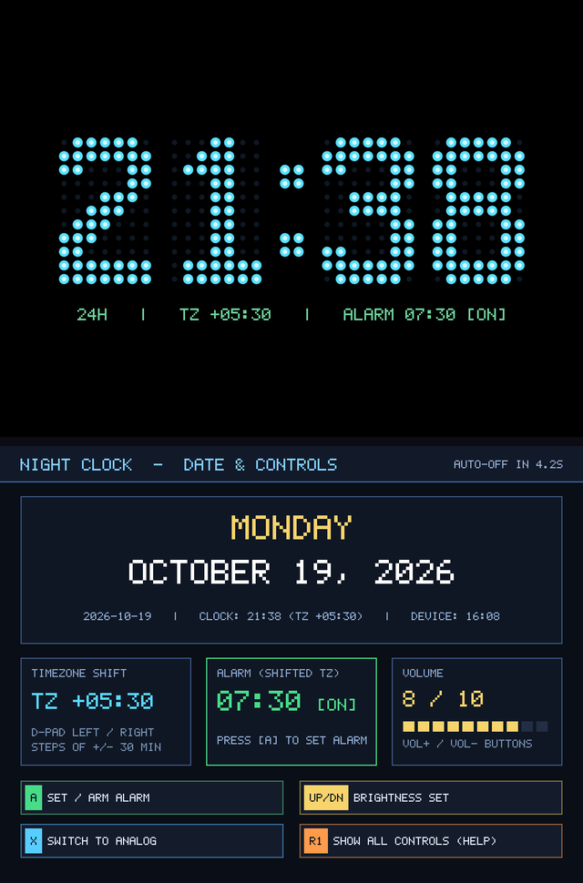
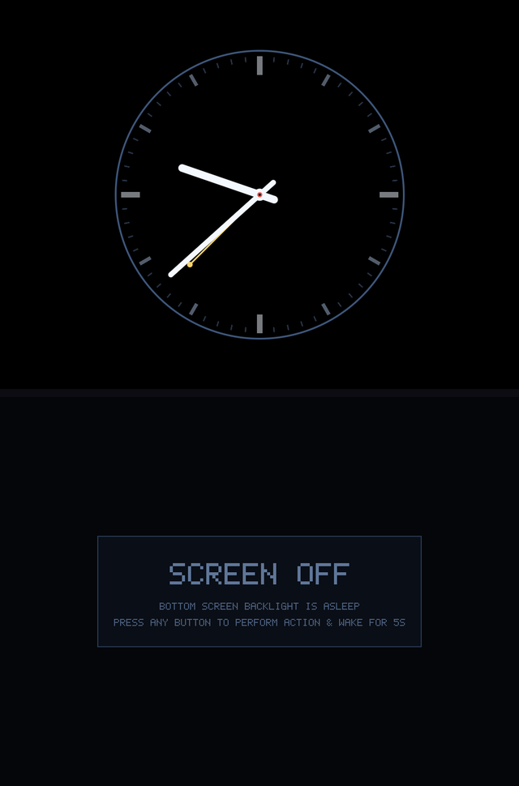
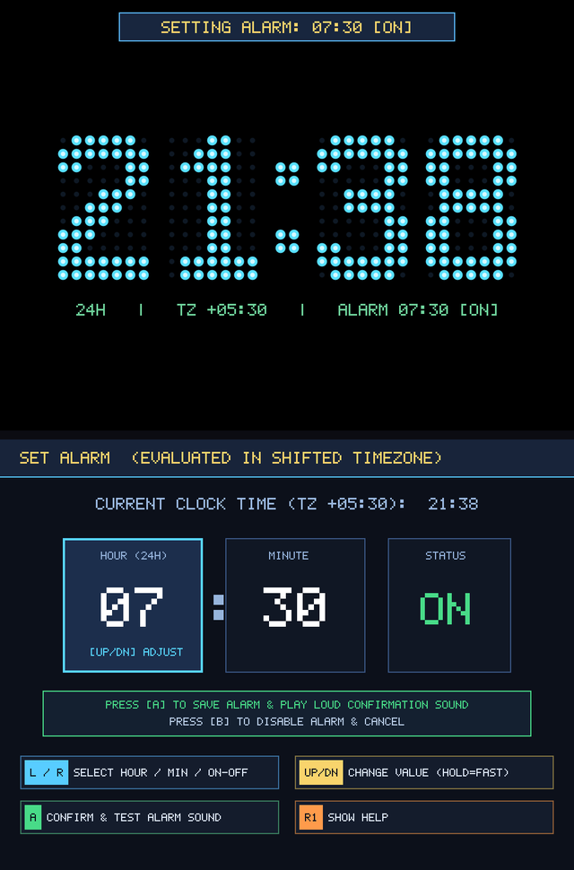
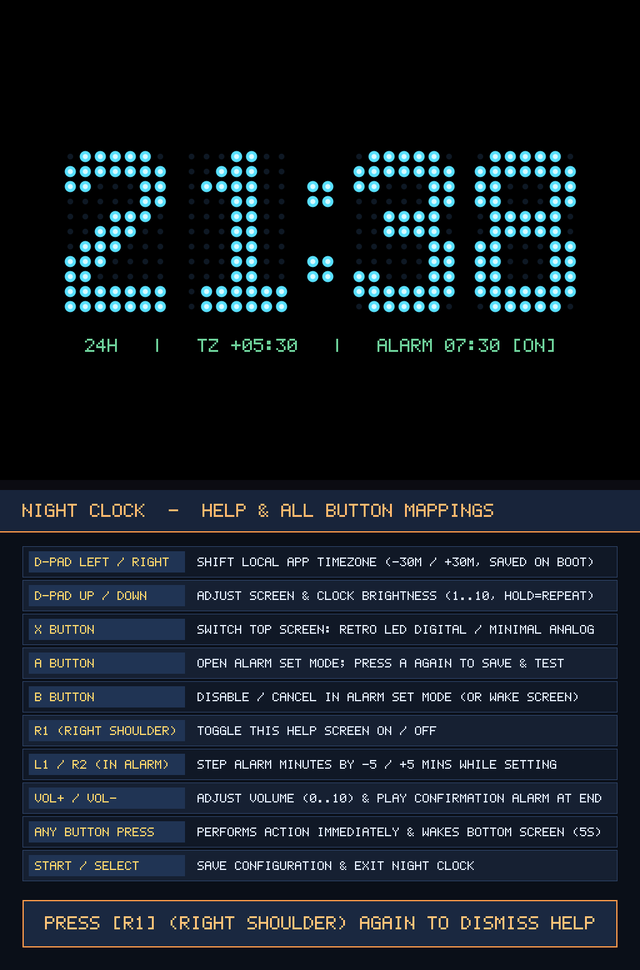

# Anbernic RG DS Plus Dual-Screen Night Clock (`1024×768` × 2)

A dual-screen bedside and desk clock built on the **Anbernic RG DS Plus C SDK (`../sdk`)** for the **Anbernic RG DS Plus** (Rockchip RK3568 `aarch64`, dual `1024×768` 4:3 IPS displays), plus a native **x86_64 Linux (X11)** target that renders both screens in a stacked clamshell window for desktop testing.

---

## Screenshots

### 1. Retro LED Digital Clock (24H) & Date / Controls View


### 2. Minimal Analog Clock & Bottom "Screen Off" State (After 5s Timeout)


### 3. Single Alarm Editor (in Shifted Timezone)


### 4. Right Shoulder (`R1`) Full Help & Button Mappings Screen


---

## Design Choices & Features

1. **App-Local Timezone Shift (`LEFT` / `RIGHT` in 30-Minute Steps)**:
   - Pressing **D-Pad `LEFT`** or **`RIGHT`** shifts the clock's displayed time and date in **30-minute increments** (`-24:00` to `+24:00`) relative to the device's clock (`TZ +00:00`, `TZ +05:30`, `TZ -03:30`, etc.).
   - The shift applies **only** to `night_clock` (the OS/device timezone and RTC are never modified) and is persisted across reboots in `.night_clock.cfg`.
   - Date rollovers across midnight, month boundaries, and leap years are handled automatically via `mktime()` normalization.

2. **24-Hour Retro LED Dot-Matrix Digital & Minimalist Analog Display (`X` Key)**:
   - **Digital Mode (Default)**: Always displays **24-hour time** (`00:00` – `23:59`, `HH:MM` without seconds) on the **Top Screen (`1024×768`)** using a custom **`7×11` Retro LED Dot-Matrix Bit-Font** (`168×264 px` per digit) with a constant (non-blinking) `:` separator.
   - **Analog Mode (`X` Key)**: Switches to a high-contrast, Braun / Swiss-railway-inspired minimalist analog clock dial (`radius = 285 px`) with bold Hour and Minute batons (no second hand) rendered using anti-aliased distance-field circles and lines for maximum readability from across a dark room, plus a muted-gold alarm indicator needle when the alarm is armed.
   - **10-Minute IPS Anti-Burn-In Orbit**: Every **10 minutes**, the clock center smoothly glides to the next position on a bounded 9-point orbit around the `1024×768` screen center (`±68 px` horizontal, `±44 px` vertical) so no static high-contrast pixels remain fixed overnight.

3. **Bottom Screen Date Display, 5-Second Auto-Sleep, Courtesy Wake, & Help (`R1`)**:
   - On launch, the **Bottom Screen (`1024×768`)** displays the full **Day of Week & Date** (in the shifted timezone), **Timezone Shift (`TZ +/-`)**, **Alarm Status**, **Volume Level (`0 / 10` .. `10 / 10`)**, and the **Critical Button Mappings** (`[A] Set/Arm Alarm`, `[UP/DN] Brightness Set`, `[X] Switch Digital/Analog`, `[R1] Show All Controls (Help)`).
   - After **5 seconds** of inactivity, the Bottom Screen turns off:
     - **On RG DS Plus Hardware**: Clears the bottom framebuffer to black (`#000000`) and powers off the lower LCD panel backlight via `/sys/class/anbernic_misc/lcdoff` (`1` when `lcdswap=0`, `2` when `lcdswap=1`) and `/mnt/vendor/bin/bright.dge`.
     - **On Linux X11 Desktop (`-DHOST_X11`)**: Mimics the hardware power-off state by displaying a dark screen with a centered **`SCREEN OFF`** overlay (`"BOTTOM SCREEN BACKLIGHT IS ASLEEP"`), and shows the full Date & Controls interface when awake.
   - **Immediate Action + Courtesy Wake on First Press**: Because the Top Screen remains visible at all times, pressing **any button** while the Bottom Screen is asleep **immediately performs that button's action** (e.g., adjusts brightness, shifts timezone, adjusts volume, toggles Digital/Analog, opens Alarm Set, or opens Help) **and simultaneously wakes up the Bottom Screen for 5 seconds** to show the date and updated state.
   - **Right Shoulder (`R1`) Help Screen**: Pressing **`R1`** opens a full **Help Screen** on the Bottom Screen listing all button mappings; pressing **`R1`** again dismisses Help.

4. **Brightness Control (`UP` / `DOWN`), Volume Indicator (`VOL+` / `VOL-`), & Single Alarm in Shifted Timezone (`A` Key)**:
   - **Brightness (`UP` / `DOWN`)**: Steps brightness across levels `1..10` (with continuous hold auto-repeat), updating both the hardware backlight (`/sys/class/anbernic_misc/brightness` + `/mnt/vendor/bin/bright.dge`) and a software RGB dimming curve (`22%..100%`).
   - **Volume Level & Confirmation (`VOL+` / `VOL-`)**: Pressing or holding **`VOL+`** / **`VOL-`** modifies the on-screen **Volume** indicator (`0..10` and 10-segment bar) in real time and, when released at the end of the adjustment, plays the confirmation alarm tone at that selected volume.
   - **Single Alarm (`A` Key)**:
     - Pressing **`A`** opens the interactive **Alarm Set Mode** on the Bottom Screen (`HOUR`, `MINUTE`, `ON/OFF` in the **shifted timezone**).
     - Pressing **`A`** again saves and arms the alarm, then immediately plays a **4-pulse dual-harmonic confirmation alarm sound** (~1.6 seconds) at the current volume.
     - When the shifted clock reaches the alarm time (`HH:MM`), both screens wake, flash a high-contrast **`ALARM RINGING`** banner, and play the repeating alarm tone until any button is pressed.

---

## Controls

| Action | Anbernic RG DS Plus Button | Linux Desktop Key (`night_clock_linux`) |
| :--- | :--- | :--- |
| **Shift Local Timezone (`-30m` / `+30m`, hold for continuous)** | **D-Pad LEFT** / **RIGHT** | `Left Arrow` / `Right Arrow` |
| **Adjust Brightness (`1..10`, hold for continuous)** | **D-Pad UP** / **DOWN** | `Up Arrow` / `Down Arrow` (or `W`) |
| **Toggle Digital (Retro LED 24H) ↔ Analog Clock** | **X** | `X`, `S`, or `Left Shift` |
| **Open Alarm Set Mode / Confirm & Play Test Alarm** | **A** | `A`, `Z`, `Space`, or `Left Alt` |
| **Cancel / Turn Off Alarm (in Alarm Set Mode)** | **B** | `B`, `Backspace`, or `Left Ctrl` |
| **Show / Dismiss Full Help Screen** | **R1 (Right Shoulder)** | `R`, `E`, or `]` |
| **Fast Alarm Minute Step (`-5m` / `+5m` in Alarm Set Mode)** | **L1 / L2** (`-5m`) and **R2** (`+5m`) | `Q` / `[` / `1` (`-5m`) and `2` / `Page Up` (`+5m`) |
| **Volume Up / Down (plays confirmation alarm at end)** | **VOL+** (`115`) / **VOL-** (`114`) | `+` / `=` and `-` / `_` |
| **Save Configuration & Exit** | **START**, **SELECT**, or **MENU (`M`)** | `Enter`, `Tab`, `M`, or `ESC` |

---

## Building & Running

### 1. Build for Anbernic RG DS Plus (`aarch64`) & SD Card Package
```bash
cd night_clock
make
```
This builds `night_clock` (`aarch64`) and populates `sdcard_package/`:
- `sdcard_package/Roms/APPS/Night_Clock.sh`
- `sdcard_package/Roms/APPS/Imgs/Night_Clock.png`
- `sdcard_package/Roms/APPS/night_clock/night_clock`
- `sdcard_package/Ports/Night_Clock/`

### 2. Build & Run on Linux Desktop (`x86_64` X11 Simulator)
```bash
cd night_clock
make linux
make run-linux
```
In `night_clock_linux`, wait 5 seconds without pressing a key to observe the Bottom Screen transition to the **`SCREEN OFF`** overlay, then press any key (such as `X` to toggle Digital/Analog, `Left`/`Right` to shift timezone by ±30m, `Up`/`Down` to adjust brightness, `A` to set the alarm, or `R`/`E`/`]` for Help) to immediately execute the action and wake the Bottom Screen for 5 seconds.
